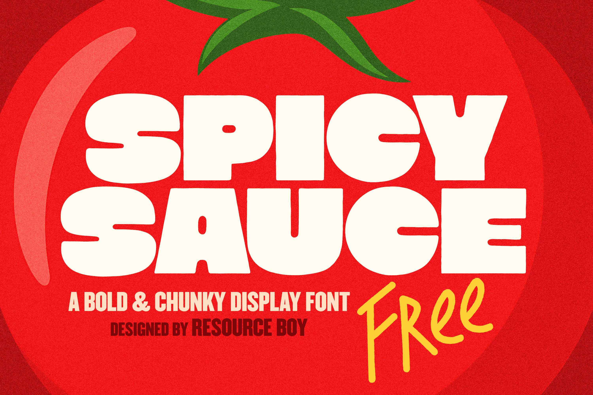
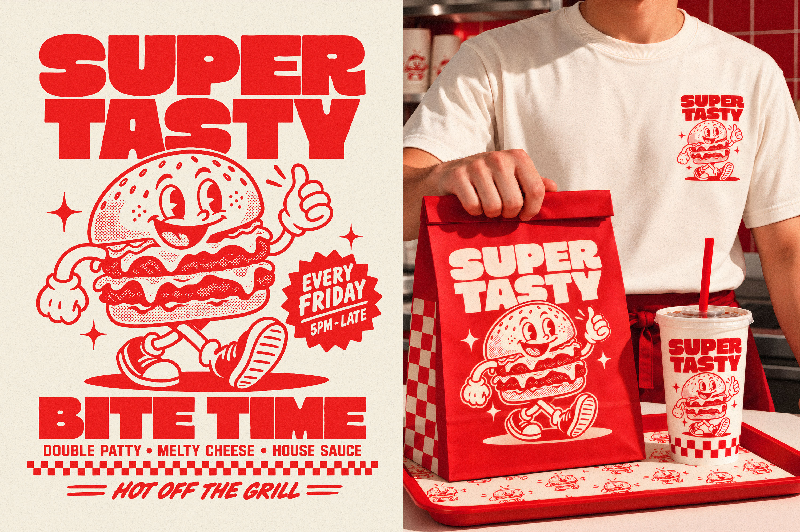
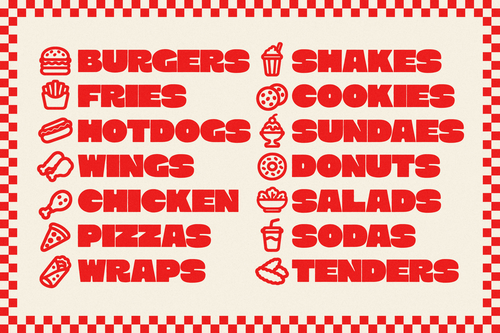
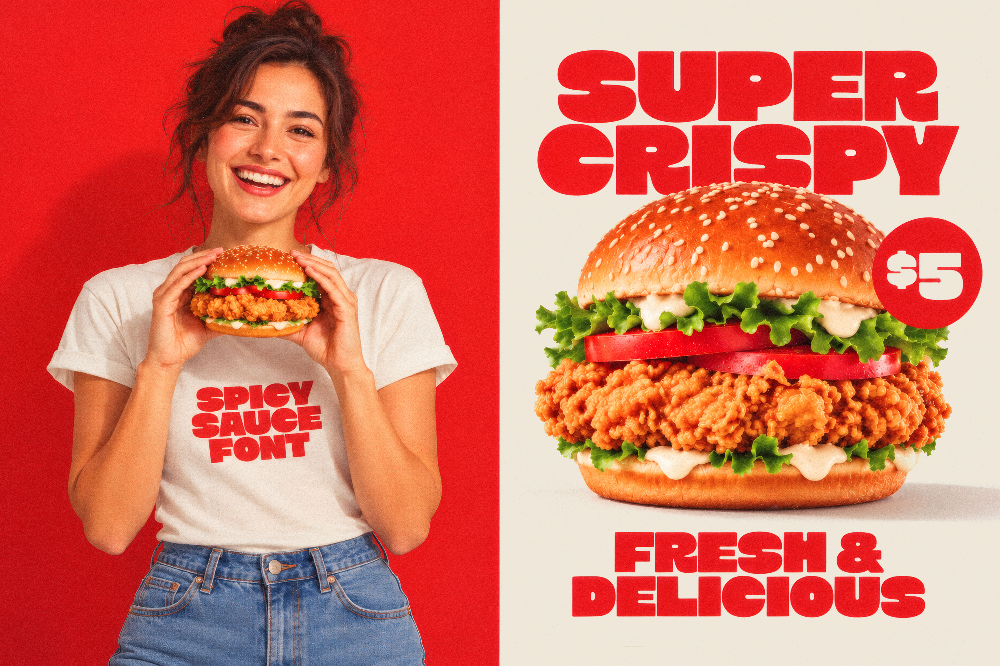
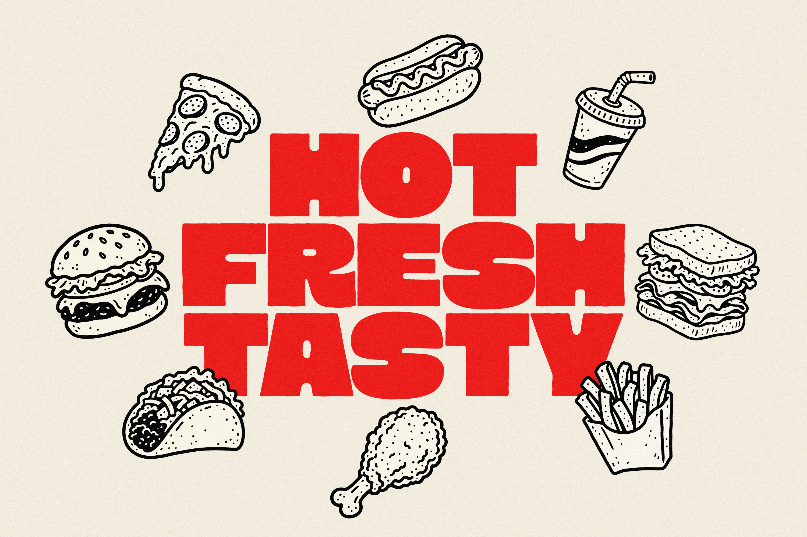
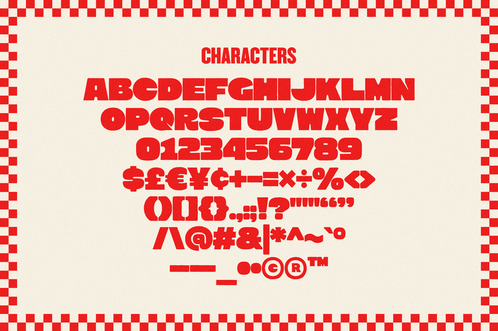

# Spicy Sauce

**Spicy Sauce** is an original bold and chunky display font designed by **Shahab Ahmadi** and published by **Resource Boy**.

Built around thick, expressive letterforms, playful proportions, and a strong visual presence, Spicy Sauce brings a lively, punchy character to restaurant branding, food packaging, menus, posters, apparel, and other attention-grabbing designs. The font includes uppercase letters, numerals, punctuation, currency symbols, and additional special characters. It does not include lowercase letters.

[View Spicy Sauce on Resource Boy](https://resourceboy.com/fonts/spicy-sauce-font/)

## Font Style

Spicy Sauce includes one style:

- Regular 400

## Preview

## Installation

Download `Spicy Sauce.ttf` from the `font` folder and install it on your system.

## License

Spicy Sauce is licensed under the **SIL Open Font License, Version 1.1**.

You are free to use, study, modify, and redistribute the font under the terms of the license.

See [OFL.txt](OFL.txt) for the full license text.

## Designer

**Shahab Ahmadi**

## Publisher

**Resource Boy**

[resourceboy.com](https://resourceboy.com/)

[View the Spicy Sauce font page](https://resourceboy.com/fonts/spicy-sauce-font/)

---

Copyright © 2026 Resource Boy
